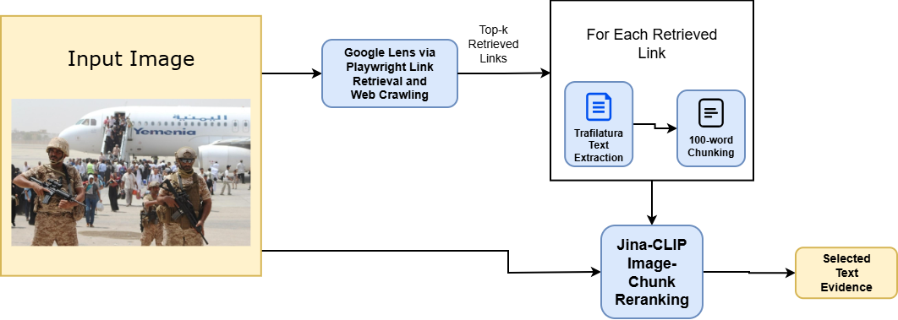
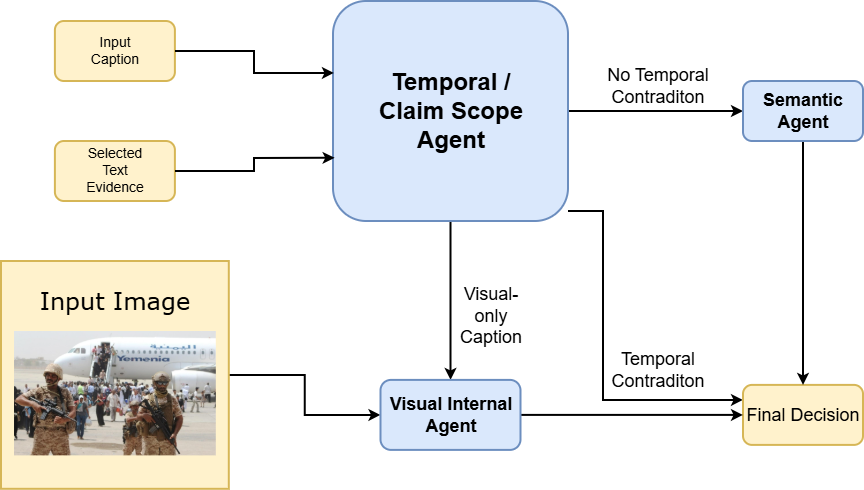

# Exploratory Experiments on OOC Verification: Linking the Findings to Practice

The exploratory experiments presented demonstrate one possible integration of the identified methodological principles into an OOC verification workflow, achieving 75.39% accuracy on the VERITE dataset. This result is intended as a preliminary feasibility demonstration rather than a state-of-the-art comparison. Also, we have not yet extensively evaluated the exploratory experiments across multiple datasets, domains, or real-world deployment settings; they aim to show how the methodological findings in the literature review can connect to a practical OOC verification workflow.

## A. Architectural Design and Operational Workflow

To examine practical challenges in unifying visual consistency, external evidence retrieval, and agentic reasoning under modality-balanced conditions, we implement a two-stage verification pipeline.

### Evidence Retrieval and Noise Filtering

Given an input image-caption pair, external contextual evidence is acquired and filtered through a coarse-to-fine procedure (see Fig. 1).

- **Coarse Cross-Modal Reranking (Jina-CLIP):** Candidate web sources are collected by querying the input image via automated reverse image search, retrieving up to 30 URLs. For each source, the extracted text is partitioned into 100-word chunks. To filter cross-domain noise and identify the image’s authentic origin, Jina-CLIP measures cross-modal semantic similarity between the input image and each candidate text chunk. The web page containing the highest-scoring chunk is selected as the primary reference article.

- **Fine-Grained Evidence Distillation (BGE-M3):** In the selected reference article, candidate chunks are scored against the claim caption using the dense-sparse multilingual retrieval model BGE-M3 to identify the semantically optimal evidence chunk. The structured Text Evidence combines: (1) the top-scoring chunk evaluated by BGE-M3, and (2) the article's Title and Lead Paragraph, preserving overarching event context alongside fine-grained details.

*Fig. 1. Overview of the external textual evidence search, retrieval, and filtering stage.*

### Deterministic Agentic Routing and Multimodal Reasoning

Reasoning is executed using small-scale open-source models (Gemma 4) through a deterministic multi-agent routing workflow (see Fig. 2 for details).

- **Temporal and Claim Scope Agent:** Powered by gemma-4-E4B-it-text-only, this agent receives the Input Caption and distilled Text Evidence. It extracts verifiable temporal markers, publication dates, and metadata to direct the claim into one of three routing paths:

  1. **`TIME_CONTRADICTION`:** When a clear temporal discrepancy is detected between the caption and historical evidence or metadata, the input is immediately routed to the Final Decision (classified as FAKE / OOC), bypassing subsequent stages to minimize latency and compute cost.

  2. **`NO_TIME_CONTRADICTION`:** When no temporal discrepancy is identified, the claim and evidence are forwarded to the Semantic Agent (gemma-4-E4B-it-text-only) for constrained factual verification against the baseline evidence.

  3. **`Visual_only_caption`:** When the caption consists purely of direct visual assertions devoid of unobservable historical or contextual entities, the instance is routed to the Visual Internal Agent.

*Fig. 2. Overview of the evidence processing, multimodal reasoning, and verification decision-making stage.*

- **Visual Internal Agent:** Powered by the multimodal vision-language model gemma-4-E4B-it, this agent evaluates `VISUAL_ONLY_CAPTION` instances by comparing the caption directly against the Input Image, excluding external text to isolate observable visual alignment.

- **Final Verdict Arbitration:** Outputs from upstream agents converge into the Final Decision. The instance is classified as FAKE if OOC miscaptioning or visual contradiction is identified, or TRUE if observable visual content aligns with retrieved textual grounding.

## B. Empirical Evaluation and Failure Mode Analysis

Experiments were conducted on the VERITE benchmark [1], which is designed with strict modality balancing to prevent models from relying on unimodal shortcuts. After excluding 98 samples with broken links or unavailable image sources from the original 1,000 instances, the valid evaluation subset comprises 902 samples (599 FAKE, 303 TRUE).

As shown in Supplementary Table S1, the pipeline exhibits a pronounced behavioral asymmetry in classification: while it demonstrates high sensitivity in detecting misleading contextual pairings (FAKE recall of 93.82%), recall on authentic instances is substantially constrained (38.94%). Qualitative error analysis reveals that this disparity stems primarily from evidence noise and LLM over-skepticism: when retrieved web snippets contain peripheral commentary, editorial variations, or localized nuances, the semantic agent frequently misinterprets benign lexical divergence as factual contradiction. This empirical finding underscores that in agentic fact-checking, preventing false alarms on authentic content requires rigorous reasoning calibration.

**Supplementary Table S1. Class-Level Verification Performance on VERITE**

| Target class | Precision (%) | Recall (%) | F1-score (%) |
|---|---:|---:|---:|
| FAKE | 75.23 | 93.82 | 83.51 |
| TRUE | 76.13 | 38.94 | 51.54 |
| Macro average | 75.68 | 66.38 | 67.52 |

**Overall accuracy: 75.39%.**

## C. Comparative Contextualization with State-of-the-Art

To provide broader context for these exploratory results, Supplementary Table S2 reports our pipeline alongside selected baselines and state-of-the-art frameworks evaluated on VERITE. The comparison should be interpreted with caution because our pipeline was evaluated on a filtered VERITE subset, whereas the reported results for other methods follow their respective published evaluation protocols. The empirical comparison in Supplementary Table S2 yields two fundamental takeaways.

**Architectural Efficiency and Open-Source Accessibility.** Unlike larger frameworks such as DEFAME, which use GPT-4o and multiple external tools for multi-step verification, our exploratory pipeline uses compact open-weight Gemma 4 E4B models and achieves 75.39% accuracy on VERITE. Although the result does not match the 83.9% reported by DEFAME, it demonstrates the feasibility of integrating lightweight open-weight models into an exploratory OOC verification workflow.

**Importance of External Visual Evidence Retrieval.** The ablation results of DEFAME highlight the potential importance of reverse image search for OOC verification. The similar performance of our exploratory pipeline further motivates external visual evidence retrieval, although this experiment does not establish that reverse image search is universally indispensable.

**Supplementary Table S2. Comparative Detection Performance on VERITE**

| Method / Framework | Core paradigm | External RIS | VERITE accuracy (%) |
|---|---|:---:|---:|
| VERITE baseline [1] | Internal cross-attention | No | 52.1 → 72.7 |
| HiEAG [2] | Evidence-augmented MLLM | Yes | 74.4 |
| GPT-4o (Zero-shot) [3] | Direct parametric reasoning | No | 78.7 |
| Our work (Exploratory) | Tri-agent + Jina-CLIP + BGE-M3 | Yes | 75.39 |
| DEFAME (w/o Reverse Search) [3] | Multi-step agentic RAG (ablation) | No | 73.7 |
| DEFAME (Full SOTA) [3] | Dynamic six-stage agentic RAG + GeoCLIP | Yes | 83.9 |

## References

[1] S. I. Papadopoulos, C. Koutlis, S. Papadopoulos, and P. C. Petrantonakis, “Verite: a robust benchmark for multimodal misinformation detection accounting for unimodal bias,” Int. J. Multimed. Inf. Retr., vol. 13, no. 1, p. 4, 2024.

[2] J. Wu, Y. Fu, N. Yu, and G. Fu, “HiEAG: evidence-augmented generation for out-of-context misinformation detection,” 2025, arXiv preprint arXiv:2511.14027.

[3] T. Braun, M. Rothermel, M. Rohrbach, and A. Rohrbach, “Defame: dynamic evidence-based fact-checking with multimodal experts,” 2024, arXiv preprint arXiv:2412.10510.
